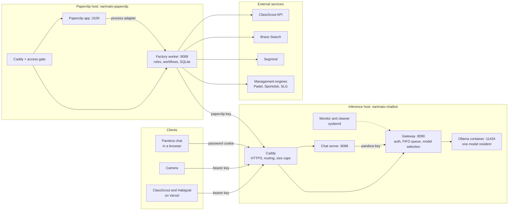
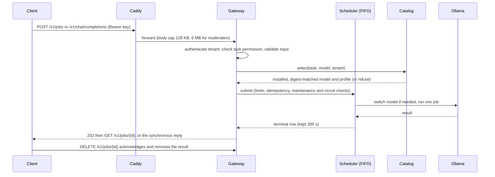
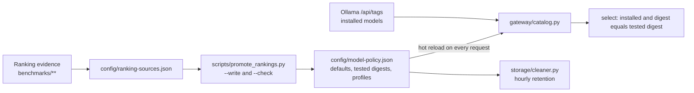
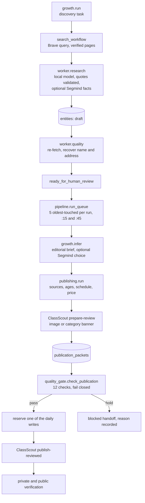

# Architecture

How the two hosts, the model gateway and the ClassScout research factory fit together, where state lives, and which limits and boundaries the code enforces. This page describes the system as the code in this repository stands. Files copied to the hosts, and what was left, are recorded in [OPERATIONS.md](OPERATIONS.md#deployed-on-2026-10-31). For decisions and dates read [HISTORY.md](HISTORY.md), for operating steps [OPERATIONS.md](OPERATIONS.md), for what changed when [../CHANGELOG.md](../CHANGELOG.md).

Contents: [System context](#system-context) · [Inference host](#inference-host) · [Paperclip host](#paperclip-host) · [Security boundaries](#security-boundaries) · [Where a fact is decided](#where-a-fact-is-decided) · [Limits and known gaps](#limits-and-known-gaps)

## System context

Two small Hetzner Cloud hosts plus the owner's Mac. The inference host serves local models to the owner's applications through one authenticated queue. The Paperclip host runs the Paperclip company application and the ClassScout research factory, which is the heaviest client of the inference host.

| Host | Address | Role |
| --- | --- | --- |
| `narimato-chatbot` | `chatbotapi.haho.ai` (2.31.100.246) | CAX11, 2 ARM64 vCPUs, 4 GB RAM. Local model inference, public benchmark dashboard, personal chat |
| `narimato-paperclip` | `paperclip.haho.ai` (2.29.113.132) | Paperclip application behind a password gate, plus the ClassScout factory |
| Owner's Mac | local | Source of truth for this repository, deploy and verify scripts, benchmark runs, nightly backup of the Paperclip host |

### Inventory

| Item | Value |
| --- | --- |
| Inference host | `narimato-chatbot`; Hetzner Cloud, Falkenstein; plan CAX11 (2 shared ARM64 vCPUs, 4 GB RAM, 40 GB disk); public IPv4 2.31.100.246 |
| Image and runtime | Docker CE on Ubuntu 24.04; Ollama in Docker (image pinned by digest); Caddy on the host for HTTPS, routing and request-size limits |
| Runtime directory | `/opt/narimato-ai` (compose file, keys, storage policy); container `narimato-ollama`; models in the Docker volume `narimato-ai_ollama` |
| API base URL | `https://chatbotapi.haho.ai/v1` |
| DNS | GoDaddy; A record `chatbotapi` pointing at the inference host, TTL 600 s |
| Consumers | ClassScout and Habigoal (on Vercel), Camera, Pandora, and the Paperclip factory |
| Paperclip host | `narimato-paperclip`; 2.29.113.132; serves `paperclip.haho.ai` behind the access gate |
| Firewall and SSH | UFW allows TCP 22, 80 and 443 (IPv4 and IPv6); no public inference port; SSH is key-only with fail2ban on both hosts ([ACCESS.md](ACCESS.md)) |

## Inference host

### Components

| Component | Entry point | Runs as | Listens | State |
| --- | --- | --- | --- | --- |
| Caddy | `config/Caddyfile.example` (live `/etc/caddy/Caddyfile`) | host `caddy` unit | :80 and :443 | certificates; static root for the dashboard |
| Ollama | `config/compose.yaml` (image pinned by digest) | Docker container `narimato-ollama` | 127.0.0.1:11434 | Docker volume with the model weights |
| Gateway | `gateway/server.py` | `narimato-gateway.service` | 127.0.0.1:8090 | `/var/lib/narimato-gateway/` |
| Chat (Pandora) | `chat/server.py`, `chat/context.py` | `narimato-chat.service` | 127.0.0.1:8088 | none; the session token is in memory |
| Moderation helpers | `moderation/server.py`, `moderation/policy.py` | imported by the gateway | none | none. The standalone service on :8089 is retired and kept for rollback |
| Monitor | `operations/monitor.py`, `alerts.py`, `notifications.py` | `narimato-monitor.service`, 30 s loop | none | `/var/lib/narimato-monitor/status.json` |
| External watchdog | `operations/external_watchdog.py` | on the Paperclip host, 30 s loop | none | `/var/lib/narimato-external-watchdog/status.json` |
| Storage cleaner | `storage/cleaner.py` | oneshot, hourly timer | none | `/var/lib/narimato-model-cleanup/` reports |
| Research collector | `research/collect.py` | oneshot, daily 03:30 Europe/Budapest (+ up to 15 min jitter) | none | `/var/lib/narimato-model-discovery/` |
| Dashboard builder | `scripts/build_dashboard.py` | run by hand through `deploy_dashboard.py` | none | `/var/www/narimato-benchmarks/` |

Caddy holds no API keys and does not authenticate; the gateway and the chat server do.

### Request flow

Public routes (Caddy): `/benchmarks/*` static and public; `/v1/{usage,models,chat/completions,jobs,jobs/*,job-types,queue,moderation/*}` to the gateway; `/chat*` to the chat server; everything else answers 401. `/internal/*` is deliberately not routed.

| Endpoint | Who | Notes |
| --- | --- | --- |
| `GET /v1/models`, `/v1/job-types` | any tenant | filtered to that tenant's permitted tasks |
| `GET /v1/queue`, `/v1/usage?hours=` | any tenant | own data only; usage covers up to 168 hours |
| `POST /v1/jobs`, `GET` and `DELETE /v1/jobs/{id}` | owning tenant | 202 on submit; DELETE returns 409 while the job runs |
| `POST /v1/chat/completions` | tenants allowed `text_chat` | synchronous, 100 s wait then 504; streaming is buffered |
| `/v1/moderation/*` | the camera tenant only | review-assistance jobs; never an automatic decision |
| `POST /internal/model-storage` | loopback and the maintenance key | acquire, renew or release the storage lease |
| `/chat/`, `/chat/login`, `/chat/api` | Pandora password cookie plus `Origin` check | one in-flight request; the backend then calls the gateway as the `pandora` tenant |

Tenants are `classscout`, `habigoal`, `camera`, `pandora` and, when its key is set, `paperclip`. Each has its own key from the gateway environment (at least 32 characters, all distinct, compared in constant time). Which tenant may run which task is in `config/job-routes.json` (`job-router.v2`).

### Scheduler and limits

One worker runs one job at a time. The values below are the code's, not the targets in any document.

| Limit | Value |
| --- | --- |
| Queue length / retained rows | 8 / 64 |
| Queued plus running per tenant | 4 (1 for `paperclip`) |
| Result retention / queue wait | 300 s / 180 s |
| Body limit | 6 MiB for the camera tenant, 256 KiB for others (Caddy caps earlier: 128 KB for `/chat`, 6 MB for moderation; the chat server repeats the 128,000-byte limit) |
| Synchronous chat wait | 100 s, then 504; input over 4096 counted tokens is refused |
| Ollama (compose) | one parallel request, one loaded model, queue 8, 2048-token default context, 30 min keep-alive, 2 CPUs, 2800 MiB |
| Extended text profile | 8192 tokens; budget is `num_ctx − max_tokens − 1536` counted with a hash-pinned tokenizer |
| Images | up to 4 MiB and 16 MP; JPEG, PNG or WebP; resized and re-encoded before inference |
| Maintenance lease | 300 s, persisted across restarts |

If an upstream failure leaves the model state unknown the circuit opens, queued work fails, and new work is refused until the process restarts.

### Model policy

Defaults follow the ranking evidence; nothing is hard-coded in the gateway.

An explicit model is accepted only when it is in the policy for that task, installed, and carries the digest it was tested with. Automatic selection means the ranked default, and for the `paperclip` tenant also the verified 8192-token context. There is no silent fallback.

The cleaner keeps a model if it is a current default, ranks in the top three of any task, had an admitted production request in the last three days, or is resident. Deletion runs only under the gateway maintenance lease (no active job, empty queue, closed circuit) and re-checks the digest first. Test traffic sends `X-Request-Purpose: test` and never counts as demand. Details: [MODEL-POLICY.md](MODEL-POLICY.md), [AUTO-MODEL-CLEANUP.md](AUTO-MODEL-CLEANUP.md).

### State and retention

| Store | Holds | Rule |
| --- | --- | --- |
| Gateway job rows | request and result, in memory only | removed 300 s after finishing or on DELETE |
| `model-usage.json` | model, digest, last request time, count | no content; test requests skipped |
| `storage-maintenance.json` | the lease token and expiry | cleared on release or expiry |
| `metrics.sqlite3` | tenant, task, model, status, timings | no content; 30 days and a row cap |
| Monitor and watchdog `status.json` | alert state and recent changes | no content |
| Cleaner reports | per-model decisions | not pruned by the code |
| Discovery registry | public model metadata | row and snapshot caps |

Request bodies, prompts, images and outputs are never written to disk. See [DATA-RETENTION.md](DATA-RETENTION.md).

### Deploy and verify

Deploy scripts run on the server, are hash-guarded and mostly single-use; the verify scripts run from the Mac against the public API and send test-purpose requests. `scripts/deploy_dashboard.py` is the one re-runnable deploy. The per-script purposes are in [OPERATIONS.md](OPERATIONS.md); retired or single-use scripts say so in their docstrings. `scripts/deploy_gateway_update.py` is retired: it refuses to run without an explicit flag.

## Paperclip host

### Layout

| Part | What it is |
| --- | --- |
| Caddy | `/_access/*` to the access gate; every other request must pass `forward_auth`; `/factory`, `/factory/metrics` to the factory worker; the rest to Paperclip |
| Paperclip container | `narimato-paperclip`, host network, bound to 127.0.0.1:3100, 2 CPUs and 2800 MiB, embedded PostgreSQL |
| Access gate | `paperclip/gate.py`: password only, HMAC cookie, 10 attempts per 15 minutes per client address, origin check |
| Factory worker | `paperclip/factory/worker.py`, a systemd service with a private state directory, 256 MiB, on 127.0.0.1:9089 |
| Bridge | `bridge.py`, the Paperclip process-adapter shim that posts a run to the worker |

The factory has no scheduler of its own. Timing comes from 19 native Paperclip routines (Europe/Budapest, skip-if-active), one 30-minute heartbeat for the Search Coordinator, per-issue monitor deadlines, assignment and approval wake-ups, and the Mac's backup job. Code lives in `/opt/narimato-factory`, state in `/var/lib/narimato-factory/factory.sqlite3`, credentials in `/etc/paperclip-*.env`.

### Factory modules, by layer

| Layer | Modules |
| --- | --- |
| Runtime | `worker.py` (HTTP, run execution, research, quality), `operational.py` (workflow router), `net.py` (bounded public web reads), `issue_pages.py`, `catalog.py` |
| Discovery and search | `growth.py`, `search_workflow.py`, `search_budget.py`, `brave.py`, `evidence.py`, `venue_identity.py` |
| Research to publication | `pipeline.py`, `publishing.py`, `formats.py`, `quality_gate.py`, `refresh.py`, `program_updates.py`, `segmind.py` |
| Support and audit | `support.py`, `site_audit.py`, `company_ops.py`, `portfolio.py` |
| Autonomy and recovery | `autonomy.py`, `company_ops.py` |
| Reporting | `business_metrics.py`, `operations_digest.py`, `dashboard.html` |
| Engines | `padel.py`, `engine_ops.py`, `slg.py` |
| Setup and one-off helpers | `provision.py`, `workflows_setup.py`, `pilot.py`, `run_batch.py`, `rework_bmf.py`, `export_batch.py`, `classscout_handoff.py` |

The five roles are Research Analyst (`research`), Content Quality Reviewer (`quality`), Support Drafter (`support`), Publication Coordinator (`publication`) and Search Coordinator (`search`). A task names its workflow on a `Factory workflow:` line; `operational.ROLES` fixes which role may run each workflow, and a mismatch is refused. Model access is serialized by locks per role group.

### Delivery pipeline

Key properties the code enforces:

- **Every fact is quoted.** A value counts only if its verbatim quote is on the fetched page (`validate_facts`); a model can add facts but never replace or invent them.
- **The gate fails closed.** `quality_gate.check_publication` runs 12 deterministic checks for a new listing (source review, identity, copy, price, ages, timetable, contacts, activity, unclaimed listing, qualified image, HTTPS sources, unambiguous contacts) and 7 for a content update. A failed check holds the packet; model confidence plays no part.
- **Writes are reserved before they are sent.** The daily cap (at most 20, default 10, counted from Budapest midnight) is consumed in the same transaction that moves the packet to `publishing`. A write whose reply is lost becomes `uncertain` and is never retried automatically; a write the catalog refuses becomes held.
- **Public verification.** A receipt counts only when ClassScout reports private (`private-mongodb`) and public (`public-api`) verification; otherwise the factory compares the stored record and the public read exactly (mirroring ClassScout's em-dash rewrite for the public text).
- **Human mode.** With the gate off, approval must be a human-only confirmation bound to the packet hash, resolved by the reviewer and not by an agent, and it expires after 48 hours.
- **Missing image.** ClassScout's own hosted category banner is accepted as a marked placeholder (`image_placeholder` in the packet proof); any other image must come from the official page.

The gate version is `classscout-auto-v6`. Other workflows reuse the same reservation and decision tables: contact and content refresh (`refresh.py`), structured program updates (`program_updates.py`), engine intake and publication (`engine_ops.py`, `padel.py`).

### Factory database

`factory.sqlite3` runs in WAL mode with foreign keys on. Modules create their own tables when first used.

| Owner | Tables |
| --- | --- |
| `worker.py` | `runs`, `sources`, `entities`, `facts`, `quality_reviews`, `model_waits` |
| `publishing.py`, `quality_gate.py` | `publication_packets`, `automatic_decisions` |
| `pipeline.py` | `pipeline_links` (the earlier `publication_cursor` table is no longer read or written; existing databases still hold it) |
| `candidates.py` | `candidate_touches` |
| `catalog.py` | `catalog_cursor`, `catalog_checks`, `workflow_reports` |
| `refresh.py`, `program_updates.py`, `portfolio.py` | `refresh_packets`, `program_packets`, `program_queue_checks` |
| `evidence.py` | `evidence_recovery`, `evidence_rechecks` |
| `growth.py` | `growth_cursor`, `commissioning_checks` |
| `search_budget.py`, `search_workflow.py` | `search_account`, `search_attempts`, `search_jobs`, `source_attempts` |
| `segmind.py` | `remote_llm_calls`, `remote_llm_state`, `remote_llm_balance` |
| `company_ops.py`, `autonomy.py` | `company_blockers`, `company_dispatch`, `blocker_sources`, `freshness_checks`, `support_knowledge`, `autonomous_recovery`, `autonomy_ticks` |
| `engine_ops.py`, `padel.py`, `slg.py`, `site_audit.py` | `engine_packets`, `engine_attempts`, `engine_cursor`, `padel_packets`, `slg_packets`, `slg_briefings`, `audit_findings` |

### External integrations

Every integration has a fixed origin and a bound in code.

| Service | Use | Bounds |
| --- | --- | --- |
| Inference host | all model calls, asynchronous jobs with `model: auto` | 8K context, 1024 output tokens, 600 s deadline, test or production purpose marker |
| Brave Search | source discovery | daily and window quotas, cooldown after failures, 2 s spacing, fixed locales, strict safe search |
| Segmind | optional paid extraction and brief choices | $10 a month, $0.40 a day, call caps, a 120% account-spend guard; a failure pauses the lane and the local result stands |
| ClassScout API | prepare-review, publish-reviewed, provider reads | fixed paths; the ingest path accepts only the operations the factory needs |
| Management engines | Padel and Sportolok catalog and intake | fixed origins and allowed paths |
| SLG | read-only sales preparation | six allowed tools; writes need explicit configuration |
| Public web | page reads | public addresses only, pinned DNS, at most 5 redirects, robots checked, ports 80 and 443 |

Budgets and caps live in `factory.json`; [paperclip/factory/SEGMIND.md](../paperclip/factory/SEGMIND.md), [BRAVE.md](../paperclip/factory/BRAVE.md), [PUBLISHING.md](../paperclip/factory/PUBLISHING.md) and [SLG.md](../paperclip/factory/SLG.md) give the details.

### Backup and recovery

The Mac pulls a recovery bundle (Paperclip database dump, an online copy of the factory database, configuration and credentials files) over SSH, verifies it, and acknowledges it on the server; seven verified copies are kept on the Mac and fourteen on the server. `paperclip/restore-drill.py` restores a bundle into an isolated container with no network and checks that no agent is active.

## Security boundaries

- Public inference traffic is authenticated by the gateway with one key per tenant; Caddy only routes and caps sizes. Ollama listens on loopback only, and there is no public inference port.
- The maintenance endpoint is reachable only from the host and only with the maintenance key.
- Prompts, images and outputs never reach disk or logs; the usage and metrics stores have no content columns. Training on production input is not done.
- Credentials live in `private/` locally (never in Git) and in root-only files on the servers. Both hosts accept only the recorded SSH key and run fail2ban.
- The factory publishes through fixed ClassScout operations only; agents cannot reach arbitrary URLs, and untrusted page text is escaped before it is posted as a comment.
- Customer data are not stored by the factory beyond public business listing facts and their source quotes.

## Where a fact is decided

| Question | Source of truth |
| --- | --- |
| Which model serves a task | `config/model-policy.json`, generated by `scripts/promote_rankings.py` from the evidence in `config/ranking-sources.json` |
| Who may call which task | `config/job-routes.json` |
| What is retained on the inference host | `config/model-storage-policy.json`, enforced by `storage/cleaner.py` |
| Whether a listing may be written | `quality_gate.py` (gate version `classscout-auto-v6`) and the daily limit in `factory.json` |
| What the factory may spend | `factory.json` (`remote_llm`, search budgets) |
| Which tasks run when | `paperclip/factory/workflows.json` and `workflows_setup.py` |
| What happened and why | [HISTORY.md](HISTORY.md), then [../CHANGELOG.md](../CHANGELOG.md) |
| What is planned | the repository's project board (`{hetzner-nano-server} - From IDEA to LIVE`); [../BACKLOG.md](../BACKLOG.md) holds the research and data-management detail |

## Limits and known gaps

This page does not repeat defects. They are recorded where they are fixed or tracked: [OPERATIONS.md](OPERATIONS.md#known-limitations) for the inference host, [../paperclip/README.md](../paperclip/README.md#known-limitations) for the Paperclip host, and the dated review in [GAP-ANALYSIS-2026-10-30.md](GAP-ANALYSIS-2026-10-30.md).
