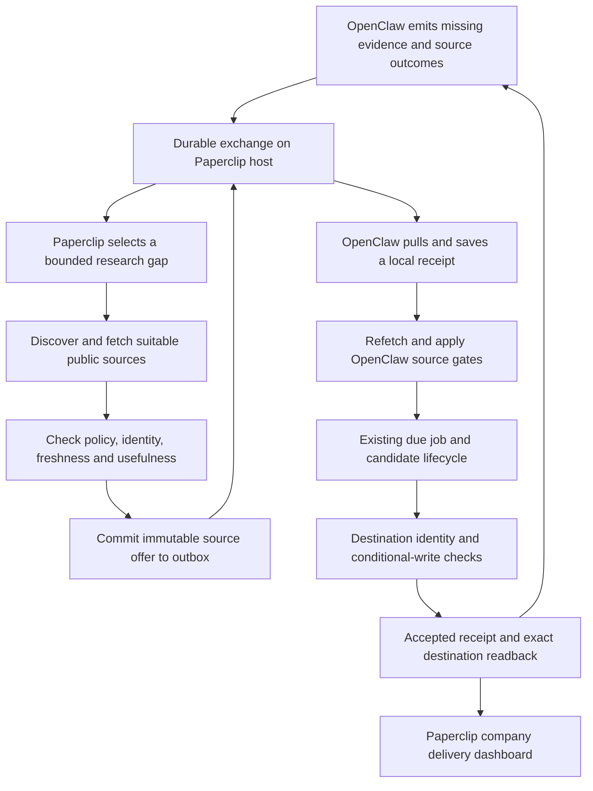

# Paperclip ↔ OpenClaw: source exchange and coordinated delivery

Status: implementation plan and API contract, prepared 1 November 2026. No exchange service, source-feed job or destination write change is enabled by this planning package. Baseline: [operational audit](https://github.com/moldovancsaba/openclaw-discoverandenrich/blob/main/PAPERCLIP-OPENCLAW-AUDIT-2026-11-01.md).

Delivery scope includes building, deploying and enabling the live exchange on both systems, followed by production acceptance and an operational handover. A contract, test-only service or shadow deployment alone does not complete delivery. This revision adds live activation to the planned work; it does not perform that activation.

> Implementation update, 2 November 2026: this document preserves the dated planning baseline. The [deployment record](integration/deployment.json) now records a real authenticated broker and a protected GDS results view. Source admission, claims and business imports remain disabled; full live exchange and pilot acceptance are pending. The current cross-repository [operations record](https://github.com/moldovancsaba/openclaw-discoverandenrich/blob/main/integration/paperclip-exchange/OPERATIONS.md) describes implemented behavior and remaining gates.

## Outcome and responsibilities

Paperclip supplies useful, freshly checked official-source leads and targeted evidence for missing fields. OpenClaw processes those leads through its existing scheduled jobs and application gates. OpenClaw returns structured gaps and outcomes, allowing Paperclip to improve the next source selection. Both show the same correlated delivery trail.

The system must run this loop itself. A person should not have to move URLs between projects, restart failed tasks or repeatedly clear the same blocker. Models extract and classify bounded evidence; deterministic adapters own transport, policy checks, retries and writes.

| Owner | Responsibility | Authority retained |
| --- | --- | --- |
| Paperclip factory | Source discovery, targeted gap research, source qualification, exchange publishing, company visibility | Its existing model/search budgets and source/publishing policies |
| OpenClaw workspace | Source intake, independent refetch, discovery/enrichment processing and outcome reporting | `jobs.json`, client settings, source policy, serial model line and existing job gates |
| Exchange service on Hetzner | Durable delivery, scoped authentication, duplicate suppression, receipts and transport health | Transport only; cannot run a job or authorize a catalog write |
| ClassScout/Management/SLG applications | Record identity, ownership, conditional writes and authoritative publication status | Their schemas, tenant scope and business rules |

OpenClaw's existing clients retain their ownership. The exchange does not introduce an autonomous chat loop, arbitrary commands, a second scheduler or a second business-candidate queue.

## Workflow

1. An ordinary OpenClaw job records a specific gap: missing street address, children/program evidence, program dates, source identity or reachable professional contact. It includes client, opaque candidate reference, reason and evidence fingerprint, without customer text or private contact values.
2. The next Paperclip coordination round consumes new gap events. Repeated unchanged gaps collapse to one research request. A fresh changed page or a released checker revision can reopen it. Limit to two follow-ups per unchanged gap in 72 hours; then keep a visible hold until conditions change.
3. Paperclip reuses its existing independent page evidence before buying another search. Search dispatch still goes through its existing budget owner. It seeks an exact official branch/program/contact page, rather than another generic homepage or directory.
4. Paperclip publishes a source packet only after fetching the public page. Discovery hints remain labelled as hints. Field claims include exact quote, fetched time and content hash. Search snippets and model confidence do not qualify a packet.
5. The Mac polls outbound HTTPS, saves the packet and a receipt durably, then acknowledges delivery. It imports a small bounded set when the existing client job is due. No model or publication work runs in the transport poll.
6. OpenClaw refetches the URL, applies its own refused-source/robots/ownership/territory gates and retains the current source version. A changed page invalidates the transferred claims; it is fresh research, not a reason to trust an old quote.
7. Normal discovery/enrichment and destination gates decide whether anything can be saved. An imported packet is never permission to overwrite a record. Existing ownership, human holds and uncertain writes remain binding.
8. Results return through a durable event outbox. Paperclip joins them to the original source packet and task. A lost HTTP response causes a safe repeated delivery, not repeated business work.

## Feeding better sources

The first pilot is **ClassScout NYC**, with extra effort on Staten Island, Queens and the Bronx under OpenClaw's existing allocation. All current categories remain eligible, including Music, Art and STEM. BOS/LA and the two Management clients follow only after the client-specific pilot passes. SLG follows with its own explicitly selected workspace and credential; a ClassScout source never becomes a sales prospect automatically.

| Source lane | What Paperclip contributes | Qualification and use |
| --- | --- | --- |
| Official branch/program pages | Exact location, registration, age, price and schedule links that resolve recorded gaps | First choice. Ownership and branch identity checked on both sides; absent facts remain absent |
| Existing approved structured sources | Fresh official-site links from OSM, Overture, DYCD and the existing swimming finder | Reuse OpenClaw's current registry and permissions. Do not duplicate a bulk download or register these as new sources |
| Existing approved directories | Provider links that the current inventory can lawfully process | Lead-only. A directory address or paragraph is not automatically official provider evidence |
| New official or association sources | Proposed source inventory entry plus a bounded sample | Keep in shadow until source policy, reuse rights, parsing and target fit are verified. No automatic policy/denylist edits |
| Existing provider gap recovery | Fresh contact, venue, registration and program pages linked from the owned host | Preserve branch scope. Headquarters evidence does not establish every branch's address |

Better means **more gate-qualified, nonduplicate sources per unit of work**, not a larger URL count. Use a deterministic priority score only after mandatory gates pass: official branch/program fit 25, relevance to a recorded missing field 20, current readable evidence 20, new branch identity 15, undercovered locality/activity 10, and recent measured source yield 10. Scores order work; they never establish a fact or relax a gate. Keep 20% of discovery allocations for exploration among approved sources so a small early sample cannot permanently suppress a source.

Do not refetch unchanged known providers solely to inflate throughput. Branch-aware deduplication uses provider identity and verified location, not bare domain. Changed evidence can reopen a previously refused candidate; transport/model failures never become terminal refusals.

Proposed pilot bounds: 20 new offers/day, at most 20 unacknowledged NYC offers, import at most five per due job and stop at the existing candidate target. The lower existing job/time/source limit always wins. Offers expire after seven days; field claims require a fresh consumer fetch before use. Expiry triggers one new bounded source check, not publication from a stale packet.

## API and authentication

Proposed origin: `https://paperclip.haho.ai/integrations/v1`. It does not exist yet. The [OpenAPI contract](integration/openapi.json) defines the proposed requests and responses. A small separate service owns its SQLite WAL transport database; it binds to loopback behind Caddy. This isolates transport availability from a model run and from the native Paperclip agent API.

OpenClaw only initiates outbound connections. Nothing new listens on a public Mac port. The browser dashboard retains its existing Pandora-style password gate. Only the exact integration prefix routes to the machine service, which checks independently revocable random bearer keys on every request. There is no broad `/api` exemption and no fallback to the shared browser password.

Issue distinct producer and consumer identities, with explicit application/client allowlists and separate scopes for source submission, source claiming, event submission and event claiming. The server derives identity from authentication, not an `actor` supplied in JSON. Cross-client claims, arbitrary callbacks, shell execution and destination credentials are outside the contract. Public status is not exposed; health/status also requires a scoped key. Support and sales send operations are absent.

| Endpoint under `/integrations/v1` | Caller | Purpose |
| --- | --- | --- |
| `POST /source-offers` | Paperclip | Persist one immutable, qualified source offer |
| `POST /deliveries/claim` | OpenClaw | Lease up to the configured bounded batch |
| `POST /deliveries/{delivery_id}/receipt` | OpenClaw | Confirm durable local intake or an explicit refusal |
| `POST /events` | OpenClaw | Persist a gap, processing outcome or exact readback event |
| `POST /events/claim` | Paperclip | Lease return events for company reconciliation |
| `POST /events/{delivery_id}/receipt` | Paperclip | Confirm durable consumption of an event |
| `GET /operations/{operation_id}` | Original caller | Reconcile an unknown HTTP outcome by exact operation ID |
| `GET /status` | Scoped operator | Bounded backlog, oldest age and last contact; no page/contact text |

Each mutation has a persisted UUID `Idempotency-Key`. The original request bytes are retained in the local transport outbox and resent unchanged; the broker binds key to principal, operation route and SHA-256 of those bytes. Same key and body returns the original response. Same key with different bytes/route fails with conflict. Timeouts are reconciled through the same key or operation lookup, never through a new key. These IDs are transport request IDs, separate from stable source/candidate IDs.

## Reliability and state ownership

Delivery is **at least once with idempotent effects**. It is not a blanket promise of exactly-once execution across independent databases. A transactional outbox avoids the gap between saving a local change and announcing it; the receiver must still deduplicate redelivery. This follows the [transactional outbox design](https://docs.aws.amazon.com/prescriptive-guidance/latest/cloud-design-patterns/transactional-outbox.html) and [idempotent API guidance](https://aws.amazon.com/builders-library/making-retries-safe-with-idempotent-APIs/).

- **Paperclip source state:** a committed source-offer record and its pending outbound message share one transaction in the existing factory database. The broker owns delivery only, not a second source-quality lifecycle.
- **Broker state:** store message, consumer-bound delivery, lease generation/token, idempotency result and acknowledgement transactionally. SQLite full synchronous commits and bounded busy retries are required. Disk-full/corruption refuses new receipts instead of acknowledging unsaved work.
- **OpenClaw intake:** the durable receive receipt and inbox payload commit together before transport acknowledgement. Later, the due job's independently checked candidate insertion, inbox transition and outcome event commit together. Transport receipt does not claim that validation or business processing has finished. Current ClassScout candidate JSON files cannot provide that second transaction with a separate SQLite inbox. First move the existing candidate lifecycle behind one shared transactional store and migrate every seeder/create/write-back reader and writer. JSON files may remain generated read-only views. Do not operate old JSON writers beside the new store or add a parallel bridge-owned business queue.
- **Scheduling:** reuse the existing worker tick for bounded transport synchronization before/after jobs, and the existing Paperclip coordination tick for publication of offers and reconciliation. Transport must run before the business-job pause/lock checks, obey a separate short time budget and perform no inference. A paused business job may acknowledge durable transport intake but cannot process it. No extra scheduler or model user is introduced.
- **Leases:** start with a two-minute lease and a maximum five-minute bound; processing the business candidate is not performed under the lease. Lease token/generation fences stale acknowledgements. A committed exact receipt can be retrieved after a lost response; otherwise an expired lease is reclaimed normally. Claimed messages remain stored until durably acknowledged, expired with a recorded reason, or held visibly.
- **Retries:** full-jitter exponential backoff with a 15-minute ceiling, honor `Retry-After`, and reserve paid usage before provider dispatch. Authentication/contract conflicts stop that delivery for attention. Quota/network/model failures are deferred. After ten failed transport attempts, retain the message in a visible held state; a controlled replay retains its original identity. Healthy unrelated clients continue.
- **Backpressure:** transport bounds are independent of business queue limits. When either receiver reaches capacity, stop claiming and return a retry deadline. Never drop the oldest unprocessed candidate to accept a new one.
- **Retention:** unacknowledged, uncertain and held work is not age-pruned. Keep acknowledged content/receipts for 90 days; retain deduplication tombstones beyond the entire allowed replay/backup horizon. Reject replay older than that supported horizon explicitly. Retain low-detail aggregates separately. Do not retain raw customer conversations or full Brave responses.
- **Restore:** include broker state, both local outboxes, deduplication and cursor state in coordinated recovery evidence. Pause draining after restore; reconcile exact operation/destination IDs before replay. An older quota or idempotency snapshot must not authorize spending or repeats. Proposed pilot RPO ≤1 hour with off-host transport snapshots, RTO ≤4 hours; these are targets requiring a drill, not existing guarantees.

## Destination writes: the gate before active exchange

The exchange's idempotency protects packet delivery. It cannot prevent two existing writers from modifying the same application record.

Before a bridged candidate can publish, both integrations must use destination-enforced operation IDs and conditional updates. Use a unique stable location/business identity for creation, a stored operation fingerprint and receipt, a current revision for changes, allowlisted fields and an authenticated writer identity. The application must atomically check revision/identity, apply fields, increment revision and save the operation result. A repeated identical operation returns the stored result; a changed operation cannot reuse its ID. A stale revision fails without writing. HTTP `If-Match`/precondition semantics are defined in [RFC 9110](https://www.rfc-editor.org/rfc/rfc9110.html#name-if-match).

An application-generated opaque strong revision is preferable to a last-updated timestamp: OpenClaw intentionally advances attempt timestamps even when business content does not change. Keep attempted-at, verified-at and changed-at distinct.

Management additionally needs an exact, scoped card→listing status read so acceptance and publication remain separate. SLG needs persisted field/contact provenance and exact record readback; its existing acceptance response is insufficient evidence that every requested field was stored.

Until the destination contract is deployed and both old write paths participate, operate in shadow. A local broker lease or an informal ownership spreadsheet is not an alternative. If a destination cannot be changed, assign an exclusive enforced writer for that client and route the other system's proposals to it; do not enable overlapping autonomous writes.

## Improvements delivered by the implementation

| Project | Change | Completion evidence |
| --- | --- | --- |
| Paperclip | Evidence-qualified source outbox and gap-event consumer | Durable offer/task correlation; no duplicate follow-up from an unchanged event |
| Paperclip | Source-yield and cross-system dashboard | Per-client qualified sources, processed records, exact readbacks, holds and freshness, without double counting both systems |
| Paperclip | Shared search-budget owner | No separate OpenClaw Brave allowance; broker dispatches existing allowed search operations and retains uncertain attempts |
| OpenClaw | Transactional candidate/intake/outcome state | Crash at every handoff boundary yields one candidate and a recoverable receipt |
| OpenClaw | Paperclip-style safe source transport | All source, robots, image and linked reads reject private destinations, unsafe redirects and oversized bodies |
| OpenClaw | Durable write intent and reconciliation | Timeout after a destination commit cannot create a duplicate or silently replay a mutation |
| Both | Correlated outcome vocabulary | Received ≠ queued ≠ checked ≠ accepted ≠ readback-confirmed ≠ public; unknown is explicit |
| Both | Enforced writer coordination | Simultaneous conflicting requests produce one valid write and a visible conflict |
| Applications | Revision/idempotency/provenance/status contracts | Exact destination tests and controlled receipts from the real integration path |

Centralize search usage at Paperclip's existing account ledger rather than adding another allowance. OpenClaw's current durable-Brave restriction remains binding: source sharing must not smuggle cached search results around that policy. Its independent Mojeek budget remains separate. Share only independently fetched public-source evidence through approved source-policy paths.

## Step-by-step delivery and release gates

| Step | Concrete work and owning repository | Gate before moving on | Indicative engineering effort |
| --- | --- | --- | --- |
| 1 | Review this contract against existing schemas; create migration fixtures and security/failure cases in Hetzner and OpenClaw | Explicit client mapping and state ownership; contract examples and failure expectations agree | 1–2 days |
| 2 | Build broker and scoped authentication in Hetzner; local outbox/inbox adapters in both systems; no production candidate imports | Crash/restart, duplicate, wrong-client, changed-body, stale-lease, disk-full and offline tests pass | 3–5 days |
| 3 | Migrate OpenClaw candidate state through a shared adapter; harden its public-source fetch paths | All existing queue writers use the adapter; isolated migration/restore and fetch fixtures pass; normal job ordering preserved | 3–5 days |
| 4 | Add destination idempotency, revisions, writer scope and exact Management readback in application repositories | Both current writers participate; concurrent and uncertain-write tests pass; no bypass through an older route | 3–5 days |
| 5 | Deploy the persistent exchange service, narrow authenticated route and both production adapters; provision scoped credentials and recovery protection; observe source offers and return events in shadow | Authenticated HTTPS and both directions work on the real hosts; restart/recovery checks pass; two natural processing cycles and at least 20 unique eligible packets observed; no unintended writes or private payloads | 1–2 days plus natural-run waiting |
| 6 | Enable the live NYC source feed and return-event loop under the proposed limits; let ordinary scheduled jobs do the work | Complete the live-exchange acceptance below; seven-day cohort review, or extend if fewer than 20 processed packets; zero unsupported writes; recoveries demonstrated | 1 day plus observation |
| 7 | Expand to BOS/LA, Management, then the selected SLG workspace one at a time; add shared dashboard panels | Each client repeats its own contract/policy/readback checks and confirms an owner | 2–4 days |
| 8 | Deliver the production acceptance record, live dashboard links, recovery evidence and operator handover | State exactly which clients are live, held or awaiting inputs; all completion evidence below is recorded; remaining cohort observation is explicitly pending | Half a day after acceptance |

Effort is approximate and sequential dependencies matter. No multi-agent delegation is assumed. Application production changes and policy changes must follow each owning repository's delivery rules. The planning package does not provision keys or silently enable disabled repair/backup/model activities.

Pilot success targets: at least 25% relative improvement in gate-qualified candidates per expensive examination versus the same client's prior comparable cohort; at least 95% of valid packets durably acknowledged within two actual available poll intervals; zero silently lost acknowledged messages, duplicate business effects, cross-client disclosures or unsupported published fields. Report sample sizes, unknown outcomes and external outages. These are acceptance targets, not promised results; the pilot can fail and remain limited without lowering gates.

## Live exchange deployment and completion

### Production installation

1. Capture the actual deployed code, queue state, pending writes and existing work before migration. Take consistent backups of the affected stores and record source hashes. Drain affected business work without clearing guards, locks or receipts.
2. Install the exchange as a dedicated system service on the Paperclip host, with a persistent state directory, restrictive permissions, bounded resources/logs and automatic restart after failure or host reboot. Keep its listener on loopback. Run additive migrations before routing traffic and test readiness against the actual transport database.
3. Generate separate production machine keys for the Paperclip producer/event consumer and the OpenClaw source consumer/event producer. Store them through each project's restricted secret mechanism, with explicit NYC scopes. Never reuse browser passwords or destination API keys. Verify rotation and revocation through a controlled test identity before commissioning production traffic.
4. Validate and reload the exact Caddy integration route. Verify TLS, correct-key access, missing/wrong/revoked-key refusal, client-scope refusal and preservation of the browser password gate on all existing UI/API routes. Leave no unauthenticated route or public Mac listener.
5. Deploy the Paperclip outbox/event-consumer adapter and OpenClaw inbox/event-producer adapter. Connect both to their existing scheduled ticks with short transport budgets. Verify that business pauses and the model's serial lock retain their original behavior. Keep candidate import and business writes off during shadow acceptance.
6. Include the exchange database, local transport stores and credential recovery material in restricted backups. Integrate transport health, oldest pending age and held delivery counts into existing operational checks and dashboards. Use existing owner-report channels; do not introduce a new recurring notification stream. Complete an isolated restore and reconnect rehearsal before enabling live imports.

### Activation on both systems

After the destination-write and shadow gates pass, enable Paperclip source publication and OpenClaw NYC imports together with return-event synchronization. Use the existing search allowance, proposed pilot bounds and ordinary business schedules. Record the activation time, installed revisions, enabled client scopes and effective limits in a generated deployment record.

Observe both directions in production: a real Paperclip source offer reaches a durable OpenClaw receipt and a normal scheduled job; that job independently checks the source and returns an outcome; Paperclip durably consumes it and updates the company view. Then observe a real OpenClaw gap event creating at most one bounded Paperclip follow-up and its resulting source response. If no genuine gap is available, report the reverse research loop as awaiting natural evidence rather than manufacture business work.

A legitimate evidence rejection proves that the source was processed; it does not prove a publication. Verify actual eligible writes by exact destination operation/readback. Never create a fixture listing or relax a gate to obtain a positive receipt.

### Required acceptance and handover

The live-exchange delivery record must include:

- The authenticated HTTPS origin and the company dashboard link, plus per-client enablement. Health reflects actual database/adaptor checks rather than a static success response.
- Correlated IDs and timestamps for a genuine source offer, durable local intake, normal scheduled processing, returned outcome and dashboard reconciliation. Include the reverse gap/research/source loop when naturally evidenced; any missing leg remains explicitly pending.
- Demonstrated recovery after an adapter/service restart and a bounded connectivity interruption. No acknowledged packet is lost and duplicate redelivery creates no duplicate candidate or business effect. Run fault injection with isolated test identities/fixtures, without disrupting unrelated production work.
- Backup/restore results, credential rotation/revocation results and the tested switches for pausing publication/imports while preserving receipts and pending work.
- A concise operating guide: how to see backlog and held messages, distinguish source rejection from transport failure, reconcile an uncertain write and roll back code without restoring obsolete ledgers.
- The pilot cohort report after its required observation period, with sample sizes, search use, candidate usefulness and verified business outcomes. Mark this review pending until the full period and sample gate are met.

Report separate milestones: **transport deployed**, **live NYC exchange verified**, **pilot outcome evaluated**, and **additional client enabled**. Do not mark the full plan complete while a required milestone is pending. An SLG credential/workspace dependency must be listed as a specific pending client; it does not prevent commissioning the NYC exchange.

## Failure and rollback checks

[Acceptance scenarios](integration/acceptance-scenarios.json) specify the required failures and observations. Tests must include loss of a response after a destination commit, not just an HTTP error before the request is sent. A passing broker unit test does not prove the destination write contract.

Provide independent switches for source publication, source import, result synchronization and business writes. Rollback pauses new imports/writes, drains or visibly holds existing work, and retains receipts/outboxes/cursors. Restore source code with backward-compatible database access; never overwrite newer receipts, quota reservations or destination revisions with a pre-pilot database. Existing non-bridge jobs may resume only when their original write and lock guarantees still hold.

The final release evidence must link source offer → local receipt → scheduled job → destination operation → exact readback → dashboard result, plus a restart/offline/restore rehearsal. No future reliability claim is earned solely by this design document or its API schema.
